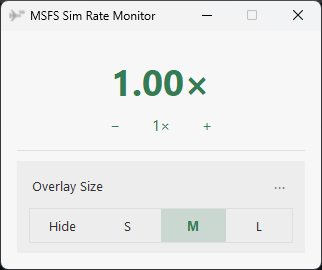
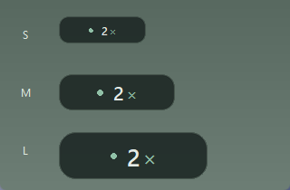

# MSFS Sim Rate Monitor

A small Windows utility that displays and controls the simulation rate in Microsoft Flight Simulator 2024. It connects through SimConnect and runs outside the simulator.

This fork adds speed controls, a system tray menu, saved preferences and a rounded overlay to [faker2048's original project](https://github.com/faker2048/MSFS-SimRateMonitor).

## Download

Download `MSFS-SimRate-Monitor.exe` from the [latest release](https://github.com/Holorigg/MSFS-SimRateMonitor/releases/latest) and run it. Python is included in the executable; no installation in the Community folder is needed.

The ZIP contains the same executable, this README and dependency licenses.

Requirements: Windows 10 or 11, 64-bit, and MSFS 2024.

## Controls



| Control | Action |
| --- | --- |
| `−` | Decrease the simulation rate by one step. |
| `+` | Increase the simulation rate by one step. |
| `1×` | Return to normal speed. |
| Hide / S / M / L | Hide the overlay or select its size. |
| `⋯` | Open startup, tray and exit options. |

The simulator determines the available rate steps. Controls stay disabled until a valid rate is received. The displayed value comes from the simulator.

The `1×` command checks the result. If direct setting is ignored, the app tries rate steps for up to eight seconds, then reports an error if the rate is still different.

## Overlay



The overlay has a translucent dark background, rounded corners and three sizes. Drag it to move it; its position and size are saved. Values are shortened to `2×`, `0.5×`, etc. A muted dot and dash indicate that rate data is unavailable.

The images above show simulated rate data.

## System tray

Minimize the window or choose **⋯ → Hide to tray** to keep the app running in the notification area. The overlay remains visible.

Click the tray icon to restore the window. Right-click it for speed controls and **Exit**. Closing the main window also exits the app.

Enable **⋯ → Start minimized to tray** to apply that behavior on the next launch. For a single launch, use:

```powershell
.\MSFS-SimRate-Monitor.exe --minimized
```

If the tray cannot be created, the app opens its main window.

## License

MIT, retaining the original project's copyright notice. Dependency licenses are included in the release ZIP.
